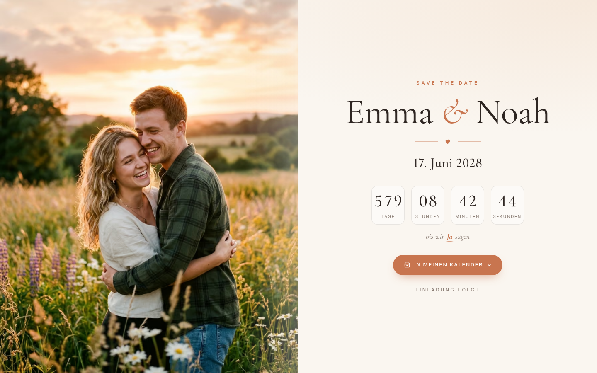

# Save the Date – Wedding Website Template

A modern, minimalist single-page **Save the Date** website built with **Vite, React 19, TypeScript, and Motion**, ready to deploy on **GitHub Pages**.

Every variable—including couple names, wedding date, countdown target, **photo file path**, calendar invite (`save-the-date.ics`), HTML `<meta>` tags, and Open Graph link preview (`og-image.jpg`)—is configured in a single root configuration file ([`wedding.config.ts`](wedding.config.ts)), with a ready-to-copy template in [`wedding.config.example.ts`](wedding.config.example.ts).

---

## Preview

*(Shown with the placeholder configuration from [`wedding.config.example.ts`](wedding.config.example.ts): **Emma & Noah · June 17, 2028**)*

### Desktop (Split Layout)



### Intro Animation & Mobile Views

| Calligraphic Heart (Drawing) | Calligraphic Heart (Complete) | Mobile View | Calendar Menu |
| :---: | :---: | :---: | :---: |
|  |  |  |  |

### WhatsApp / iMessage Link Preview (`og-image.jpg`)

Automatically generated at build time with the configured names and date:


---

## Features

- **Single Config File (Including Image Path):** Set names, date, countdown timestamp, venue, and image path in [`wedding.config.ts`](wedding.config.ts). Use [`wedding.config.example.ts`](wedding.config.example.ts) as a clean starting template.
- **Calligraphic Hand-Drawn Intro:** Variable-width nib strokes drawn via animated SVG masks with crossing ribbons, an open heart cleft, and your custom names & date inside. Tap anywhere to skip, or click the small heart divider on the main page to replay anytime. Respects `prefers-reduced-motion`.
- **Responsive Editorial Layout:** Full-bleed vertical fade on mobile (`< 900px`) and a 50/50 split screen on desktop (`≥ 900px`).
- **Build-Time Image Optimization:** Uses `vite-imagetools` to automatically generate responsive `AVIF`, `WebP`, and `JPEG` `srcset` variants (`640w`, `960w`, `1280w`, `1500w`) for the image configured in `wedding.config.ts`.
- **Smooth Rolling Countdown:** Live days, hours, minutes, and seconds counter aligned to exact second boundaries.
- **One-Click Calendar Integration:** Supports **Apple Calendar**, **Google Calendar**, **Outlook**, and a standards-compliant **RFC 5545 `.ics` download** (`save-the-date.ics` with 7-day `VALARM` reminder) generated at build time.
- **Automatic Open Graph Card:** Dynamically generates a `1200 × 630` JPEG preview card (`og-image.jpg`) and Open Graph `<meta>` tags from `wedding.config.ts` so links shared in WhatsApp, iMessage, or Signal display a clean calligraphy card while keeping the couple photo as a surprise.
- **Multi-Device Headless UI Test Suite:** Automated real-browser tests across 16 mobile, foldable, tablet, and laptop viewports (`320×568` up to `1920×1080`).
- **Privacy-Friendly & Self-Hosted Fonts:** Bundled locally via `@fontsource-variable` (`Cormorant Garamond` & `Inter`) with zero external requests to Google Fonts, plus `noindex, nofollow` meta tags.

---

## Reusing This Template for Your Own Wedding

### 1. Copy the Example Config

Start from [`wedding.config.example.ts`](wedding.config.example.ts) and edit [`wedding.config.ts`](wedding.config.ts):

```bash
cp wedding.config.example.ts wedding.config.ts
```

### 2. Add Your Photo & Edit [`wedding.config.ts`](wedding.config.ts)

Place your photo in `src/assets/` (for example `src/assets/my-photo.jpg`, recommended portrait resolution: `1200 × 1600 px` or higher) and configure all variables in [`wedding.config.ts`](wedding.config.ts):

```ts
import { defineWedding } from './src/weddingSchema.ts'

export default defineWedding({
  names: ['Emma', 'Noah'],
  date: '2028-06-17',
  countdownTarget: '2028-06-17T00:00:00+02:00',
  image: 'src/assets/sample-couple.jpg',
  photoPosition: '50% 35%', // CSS object-position to keep faces centered
  location: undefined,      // e.g. 'Munich' — displays locationFallback when undefined
  locationFallback: 'Einladung folgt',
  title: 'Hochzeit von Emma & Noah',
  details: 'Save the Date! Die Einladung mit allen Details folgt.',
  icsFileName: 'save-the-date.ics',
})
```

Changing `wedding.config.ts` automatically updates:
- The hero photo (including responsive `AVIF`/`WebP`/`JPEG` build optimization), headline, formatted date, and `alt` text
- The calligraphic heart intro animation (`names` and `DD · MM · YY` date)
- The countdown timer target
- Google Calendar, Outlook, and Apple Calendar / `.ics` (`save-the-date.ics`) invites
- HTML `<title>`, `<meta name="description">`, Open Graph tags, and the generated `og-image.jpg` link preview image

*(Optional)* To customize colors, adjust the CSS custom properties in [`src/styles/global.css`](src/styles/global.css).

---

## Local Development & Testing

```bash
npm install
npm run dev              # start local dev server at http://localhost:5173/
npm run dev -- --host    # expose dev server on local Wi-Fi (for testing on iPhone / Android)
npm test                 # run unit tests + 16-viewport headless Chrome UI suite
npm run test:ui:headed   # watch the 16-viewport UI test suite live in a visible Chrome window
npm run lint             # run Oxlint
npm run build            # typecheck & build production bundle into dist/
npm run preview          # preview production build locally at http://localhost:4173/
```

---

## Deploying to GitHub Pages

1. Push your repository to GitHub (`main` branch).
2. In your GitHub repository, open **Settings → Pages → Build and deployment → Source** and select **GitHub Actions**.
3. The included workflow ([`.github/workflows/deploy.yml`](.github/workflows/deploy.yml)) automatically runs tests, builds the site (injecting the absolute GitHub Pages URL for WhatsApp/Open Graph previews), and deploys to `https://<username>.github.io/<repo-name>/`.
